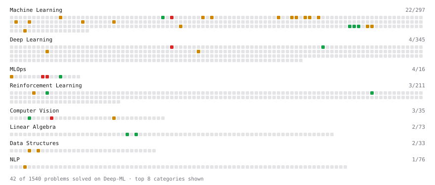

# Deep-ML

My machine learning practice from [Deep-ML](https://www.deep-ml.com). Every solution here was written by hand.

**63** solved · 62 problems · 1 labs · 0 math

[**Browse the interactive portfolio**](https://zannensk.github.io/deep-ml/) to replay this filling in over time.

## Problems

| | Difficulty | Solved | |
| --- | --- | --- | --- |
| [Balance Dataset via Undersampling](https://www.deep-ml.com/problems/1057) | easy | 2026-10-09 | [solution](problems/1057-balance-dataset-via-undersampling) |
| [Binary Classification with Logistic Regression](https://www.deep-ml.com/problems/104) | easy | 2026-09-23 | [solution](problems/0104-binary-classification-with-logistic-regression) |
| [Build a Multi-Armed Bandit Testbed](https://www.deep-ml.com/problems/542) | easy | 2026-10-12 | [solution](problems/0542-build-a-multi-armed-bandit-testbed) |
| [Calculate Cosine Similarity Between Vectors](https://www.deep-ml.com/problems/76) | easy | 2026-10-10 | [solution](problems/0076-calculate-cosine-similarity-between-vectors) |
| [Calculate P50/P95/P99 Latency Percentiles](https://www.deep-ml.com/problems/293) | easy | 2026-09-22 | [solution](problems/0293-calculate-p50-p95-p99-latency-percentiles) |
| [Compute Arithmetic Intensity and Classify Bottleneck](https://www.deep-ml.com/problems/414) | easy | 2026-10-16 | [solution](problems/0414-compute-arithmetic-intensity-and-classify-bottleneck) |
| [Convert RGB Image to Grayscale](https://www.deep-ml.com/problems/237) | easy | 2026-10-14 | [solution](problems/0237-convert-rgb-image-to-grayscale) |
| [Estimate Minimum GPU Count for Model Deployment](https://www.deep-ml.com/problems/412) | easy | 2026-09-21 | [solution](problems/0412-estimate-minimum-gpu-count-for-model-deployment) |
| [Implement Binary Cross-Entropy Loss](https://www.deep-ml.com/problems/263) | easy | 2026-10-08 | [solution](problems/0263-implement-binary-cross-entropy-loss) |
| [Linear Regression Using Normal Equation](https://www.deep-ml.com/problems/14) | easy | 2026-10-15 | [solution](problems/0014-linear-regression-using-normal-equation) |
| [Pairwise Cosine Similarity Matrix](https://www.deep-ml.com/problems/1072) | easy | 2026-10-10 | [solution](problems/1072-pairwise-cosine-similarity-matrix) |
| [Pass@k and Majority Voting Evaluation Metrics](https://www.deep-ml.com/problems/226) | easy | 2026-10-21 | [solution](problems/0226-pass-k-and-majority-voting-evaluation-metrics) |
| [Phi Transformation for Polynomial Features](https://www.deep-ml.com/problems/84) | easy | 2026-09-25 | [solution](problems/0084-phi-transformation-for-polynomial-features) |
| [Prefix Cache Hit Rate Calculator](https://www.deep-ml.com/problems/434) | easy | 2026-10-21 | [solution](problems/0434-prefix-cache-hit-rate-calculator) |
| [Random Train/Validation/Test Split with Shuffling](https://www.deep-ml.com/problems/1058) | easy | 2026-10-09 | [solution](problems/1058-random-train-validation-test-split-with-shuffling) |
| [Upper Confidence Bound (UCB) Action Selection](https://www.deep-ml.com/problems/162) | easy | 2026-10-12 | [solution](problems/0162-upper-confidence-bound-ucb-action-selection) |
| [Analyze Canary Deployment Health for Model Rollout](https://www.deep-ml.com/problems/251) | medium | 2026-10-15 | [solution](problems/0251-analyze-canary-deployment-health-for-model-rollout) |
| [Apriori Frequent Itemset Mining](https://www.deep-ml.com/problems/144) | medium | 2026-10-10 | [solution](problems/0144-apriori-frequent-itemset-mining) |
| [ASR Real-Time Factor for Parallel Chunk Transcription](https://www.deep-ml.com/problems/444) | medium | 2026-10-15 | [solution](problems/0444-asr-real-time-factor-for-parallel-chunk-transcription) |
| [Bernoulli Naive Bayes Classifier](https://www.deep-ml.com/problems/140) | medium | 2026-10-12 | [solution](problems/0140-bernoulli-naive-bayes-classifier) |
| [BLEU Score for Text Generation](https://www.deep-ml.com/problems/321) | medium | 2026-10-14 | [solution](problems/0321-bleu-score-for-text-generation) |
| [BM25 Ranking ](https://www.deep-ml.com/problems/90) | medium | 2026-10-12 | [solution](problems/0090-bm25-ranking) |
| [Build a Simple ETL Pipeline (MLOps)](https://www.deep-ml.com/problems/187) | medium | 2026-09-30 | [solution](problems/0187-build-a-simple-etl-pipeline-mlops) |
| [Calculate Expected Calibration Error (ECE)](https://www.deep-ml.com/problems/260) | medium | 2026-09-21 | [solution](problems/0260-calculate-expected-calibration-error-ece) |
| [Contrastive Loss (InfoNCE / SimCLR-style)](https://www.deep-ml.com/problems/384) | medium | 2026-10-09 | [solution](problems/0384-contrastive-loss-infonce-simclr-style) |
| [End-to-End Latency Decomposition](https://www.deep-ml.com/problems/413) | medium | 2026-09-22 | [solution](problems/0413-end-to-end-latency-decomposition) |
| [Epsilon-Greedy Action Selection for n-Armed Bandit](https://www.deep-ml.com/problems/158) | medium | 2026-10-12 | [solution](problems/0158-epsilon-greedy-action-selection-for-n-armed-bandit) |
| [Evaluate Translation Quality with METEOR Score](https://www.deep-ml.com/problems/110) | medium | 2026-10-14 | [solution](problems/0110-evaluate-translation-quality-with-meteor-score) |
| [Feature Drift Detection using Population Stability Index](https://www.deep-ml.com/problems/253) | medium | 2026-10-15 | [solution](problems/0253-feature-drift-detection-using-population-stability-index) |
| [Feature Hashing Trick for Sparse Features](https://www.deep-ml.com/problems/846) | medium | 2026-09-29 | [solution](problems/0846-feature-hashing-trick-for-sparse-features) |
| [Generate Sorted Polynomial Features](https://www.deep-ml.com/problems/32) | medium | 2026-09-25 | [solution](problems/0032-generate-sorted-polynomial-features) |
| [Handle Imbalanced Data with SMOTE](https://www.deep-ml.com/problems/357) | medium | 2026-10-10 | [solution](problems/0357-handle-imbalanced-data-with-smote) |
| [Implement a Trie for Prefix Matching](https://www.deep-ml.com/problems/1083) | medium | 2026-10-12 | [solution](problems/1083-implement-a-trie-for-prefix-matching) |
| [Implement a Vision Transformer (ViT) Image Encoder](https://www.deep-ml.com/problems/720) | medium | 2026-10-11 | [solution](problems/0720-implement-a-vision-transformer-vit-image-encoder) |
| [Implement DBSCAN Clustering Algorithm](https://www.deep-ml.com/problems/259) | medium | 2026-10-13 | [solution](problems/0259-implement-dbscan-clustering-algorithm) |
| [Implement Focal Loss for Imbalanced Classification](https://www.deep-ml.com/problems/255) | medium | 2026-10-09 | [solution](problems/0255-implement-focal-loss-for-imbalanced-classification) |
| [Implement Gradient Boosting Regressor Step](https://www.deep-ml.com/problems/344) | medium | 2026-09-25 | [solution](problems/0344-implement-gradient-boosting-regressor-step) |
| [Implement Graph Convolution Network (GCN) Layer](https://www.deep-ml.com/problems/453) | medium | 2026-10-10 | [solution](problems/0453-implement-graph-convolution-network-gcn-layer) |
| [Implement INT8 Quantization](https://www.deep-ml.com/problems/294) | medium | 2026-10-15 | [solution](problems/0294-implement-int8-quantization) |
| [Implement Isolation Forest for Anomaly Detection](https://www.deep-ml.com/problems/367) | medium | 2026-10-13 | [solution](problems/0367-implement-isolation-forest-for-anomaly-detection) |
| [Implement Precision-Recall Curve](https://www.deep-ml.com/problems/278) | medium | 2026-10-08 | [solution](problems/0278-implement-precision-recall-curve) |
| [Implement Prediction Distribution Monitoring](https://www.deep-ml.com/problems/295) | medium | 2026-10-15 | [solution](problems/0295-implement-prediction-distribution-monitoring) |
| [Implement ROC Curve Calculation](https://www.deep-ml.com/problems/276) | medium | 2026-10-08 | [solution](problems/0276-implement-roc-curve-calculation) |
| [Implement Stratified Train-Test Split](https://www.deep-ml.com/problems/275) | medium | 2026-10-09 | [solution](problems/0275-implement-stratified-train-test-split) |
| [Knowledge Distillation Loss](https://www.deep-ml.com/problems/227) | medium | 2026-10-16 | [solution](problems/0227-knowledge-distillation-loss) |
| [Online Mean and Variance with Welford's Algorithm](https://www.deep-ml.com/problems/1144) | medium | 2026-09-29 | [solution](problems/1144-online-mean-and-variance-with-welford-s-algorithm) |
| [Online Rolling Z-Score over a Fixed Window](https://www.deep-ml.com/problems/1143) | medium | 2026-09-29 | [solution](problems/1143-online-rolling-z-score-over-a-fixed-window) |
| [Pairwise Preference Judge for LLM Comparison](https://www.deep-ml.com/problems/323) | medium | 2026-10-21 | [solution](problems/0323-pairwise-preference-judge-for-llm-comparison) |
| [Polynomial Regression Fit](https://www.deep-ml.com/problems/801) | medium | 2026-10-15 | [solution](problems/0801-polynomial-regression-fit) |
| [Ranking Metrics: NDCG@k, MRR and MAP@k](https://www.deep-ml.com/problems/1408) | medium | 2026-10-01 | [solution](problems/1408-ranking-metrics-ndcg-k-mrr-and-map-k) |
| [Rubric-Based LLM Judge Evaluation](https://www.deep-ml.com/problems/317) | medium | 2026-10-21 | [solution](problems/0317-rubric-based-llm-judge-evaluation) |
| [Simulate DDP All-Reduce Gradient Averaging](https://www.deep-ml.com/problems/1027) | medium | 2026-10-21 | [solution](problems/1027-simulate-ddp-all-reduce-gradient-averaging) |
| [Tensor Parallelism All-Reduce Communication Cost](https://www.deep-ml.com/problems/438) | medium | 2026-10-23 | [solution](problems/0438-tensor-parallelism-all-reduce-communication-cost) |
| [Top-p (Nucleus) Sampling](https://www.deep-ml.com/problems/383) | medium | 2026-10-20 | [solution](problems/0383-top-p-nucleus-sampling) |
| [TTS Concurrent Real-Time Stream Capacity](https://www.deep-ml.com/problems/445) | medium | 2026-10-15 | [solution](problems/0445-tts-concurrent-real-time-stream-capacity) |
| [XGBoost Objective Function Calculation](https://www.deep-ml.com/problems/347) | medium | 2026-09-23 | [solution](problems/0347-xgboost-objective-function-calculation) |
| [A/B Test Statistical Analysis for Model Comparison](https://www.deep-ml.com/problems/269) | hard | 2026-09-30 | [solution](problems/0269-a-b-test-statistical-analysis-for-model-comparison) |
| [Designing 4D Parallelism for Large Model Training](https://www.deep-ml.com/problems/506) | hard | 2026-10-21 | [solution](problems/0506-designing-4d-parallelism-for-large-model-training) |
| [Implement a Simple CNN Training Function with Backpropagation](https://www.deep-ml.com/problems/130) | hard | 2026-10-13 | [solution](problems/0130-implement-a-simple-cnn-training-function-with-backpropagation) |
| [ML Pipeline DAG Scheduler with Critical Path Analysis](https://www.deep-ml.com/problems/270) | hard | 2026-09-30 | [solution](problems/0270-ml-pipeline-dag-scheduler-with-critical-path-analysis) |
| [Non-Maximum Suppression for Object Detection](https://www.deep-ml.com/problems/242) | hard | 2026-10-14 | [solution](problems/0242-non-maximum-suppression-for-object-detection) |
| [Train Logistic Regression with Gradient Descent](https://www.deep-ml.com/problems/106) | hard | 2026-09-30 | [solution](problems/0106-train-logistic-regression-with-gradient-descent) |

## Labs

| | Difficulty | Solved | |
| --- | --- | --- | --- |
| [Feature Deconfounder for Biased Image Data](https://www.deep-ml.com/labs/16) | hard | 2026-10-20 | [solution](labs/0016-feature-deconfounder-for-biased-image-data) |

---

_This file is regenerated by Deep-ML on every push._
